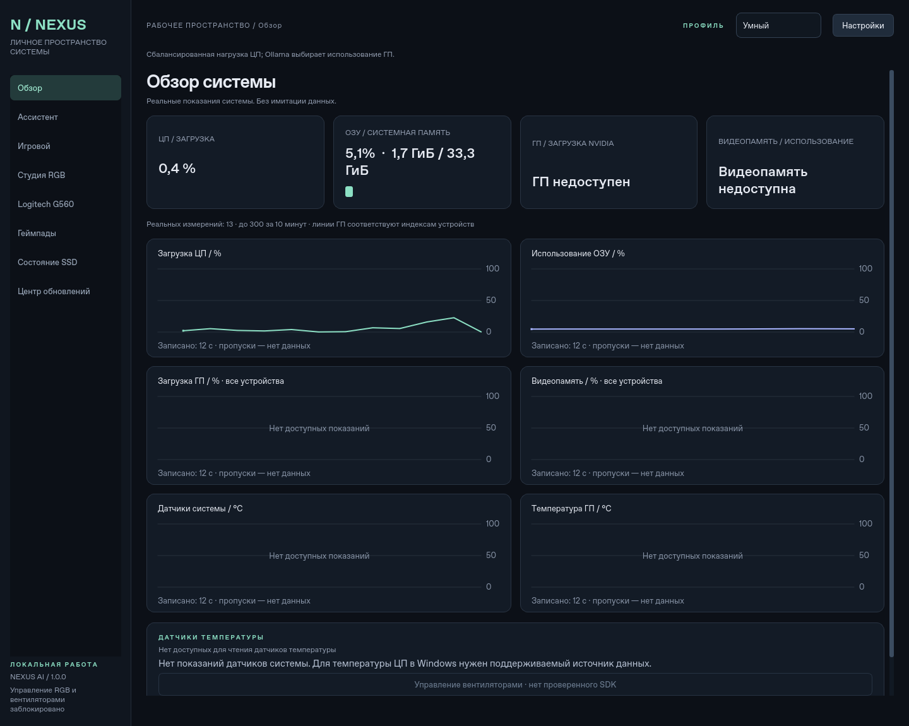
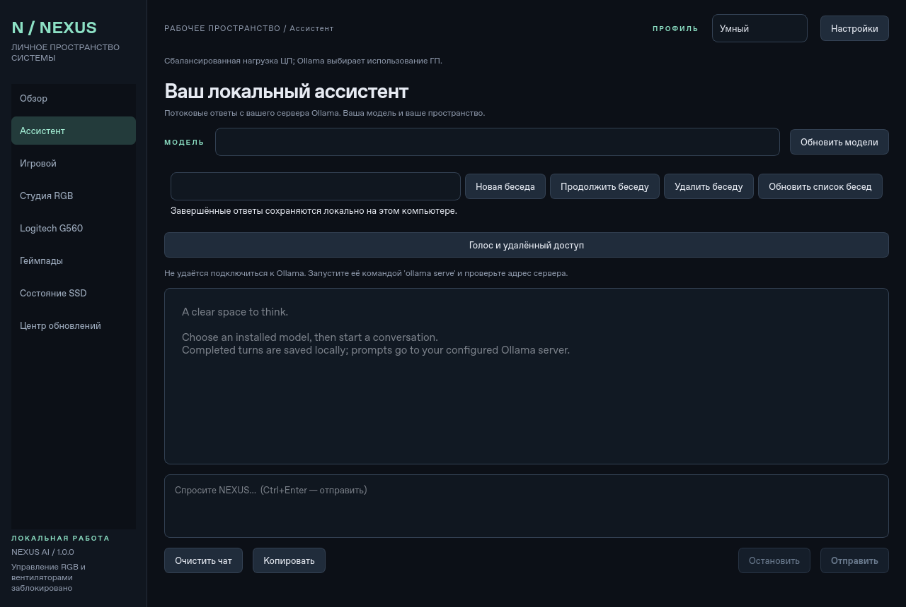

# NEXUS AI 1.0 — development preview

**[Русская документация](README.ru.md)** · [Game Center](docs/gaming.md) ·
[Storage / hardware](docs/hardware-interfaces.md) · [Update security](docs/update-security.md) ·
[Voice and conversations](docs/conversations-voice.md) · [Remote access](docs/remote-control.md)

A Windows 11 desktop application for local Ollama chat and real hardware monitoring.
Built with Python 3.11+ and PySide6, with a dark interface and background workers
for network requests and telemetry, with sidebar workspaces and bounded historical charts.

- Live CPU utilization and RAM usage from `psutil`.
- Optional NVIDIA utilization, VRAM usage, and temperature from NVML.
- Ollama model discovery and streamed chat through its REST API.
- Persistent JSON settings for the Ollama URL, model, and performance profile.
- Smart, Maximum AI, Gaming, and Eco inference profiles.

Telemetry is never simulated. Missing NVIDIA support displays an unavailable
status; it does not prevent CPU/RAM monitoring or chat. Missing Ollama displays a
connection error while the rest of the application remains usable.

## v1.0 implementation status

This is an unreleased development preview in draft PR #4, stacked on the unmerged
localized v0.4 branch. No release or automatic installation is performed.

| Feature | Working behavior and limits |
| --- | --- |
| Game Center / Game Guard | Add, edit and remove named game EXE lists; persist configuration; opt-in background process detection; switch inference mode while playing and restore the selected base profile afterwards. No process termination or OS tuning. |
| Ollama lifecycle | Use supported model load/unload endpoints in workers. Automatic unloading requires per-game consent and a model successfully used by this NEXUS session at this endpoint. No unrelated model is unloaded; shared use of the same model by another client remains an Ollama limitation. Model restoration is on demand. |
| AI conversations | Completed turns stored locally in SQLite; explicitly resume, start or delete conversations. Cancelled and failed replies are excluded. Prompts and replies are plaintext local data; do not enter secrets. |
| SSD diagnostics | Read-only Windows `Get-PhysicalDisk` / `Get-StorageReliabilityCounter`; display only counters exposed by the actual driver. Missing SMART fields remain unavailable. Wear is consumed wear, not remaining health. |
| Gamepad Lab | Read-only standard Windows XInput slots, button and stick snapshots. No Elite identity, paddles, rumble, calibration or firmware support is claimed. |
| Updates | Check the official repository's stable GitHub Releases on request. Explicitly approve downloads; SHA-256 digest and byte count are required; major-version downloads require an additional confirmation. No installer or code-signature claim. |
| Russian voice foundation | Validated-provider STT/TTS contracts and an actual allowlisted Russian/English **text** command router. No bundled microphone capture, wake word, audio recognition or synthesis. |
| iPhone remote foundation | Disabled by default. Token-authenticated web interface, bounded requests, replay protection and approved status/stop/profile commands. Loopback HTTP for local testing; LAN binds require a user-supplied trusted TLS certificate. No physical iPhone validation yet. |
| MSI / G560 / cooling | Read-only Windows device inventory and documented official interfaces. Candidate names do not establish SDK support. RGB, fan and audio writes remain disabled. |

All process, storage, device, database and network operations run outside Qt's UI
thread. Shutdown waits asynchronously for bounded work; it never kills unrelated
processes. See [security checks](docs/security.md) and [validation](docs/v1-validation.md) and [release checklist](docs/release-checklist-v1.md).
Real Windows sensor availability and physical device behavior remain unverified
until tested on the target computer. CI smoke tests validate packaging and UI,
not possession of any particular hardware.

## v0.4 dashboard

- **Overview:** dark, responsive Qt dashboard with real CPU and RAM readings,
  optional per-device NVIDIA utilization/VRAM/temperature through NVML, and named
  host temperature sensors through `psutil.sensors_temperatures` where supported.
- **History:** six Qt-painted charts for CPU, RAM, GPU, VRAM, host temperatures,
  and GPU temperatures. History is session-only, bounded to 300 samples and ten
  minutes; missing sensors produce gaps, never made-up zeros. The actual captured
  duration is displayed. GPU cards summarize the first reported device; detail
  cards and charts retain all reported GPUs.
- **Assistant:** dedicated streaming chat workspace with model selection, model
  size tooltips, copy/clear, Ctrl+Enter to send, Escape to stop, and batched text
  rendering. Persistent endpoint/model preferences and all four existing profiles
  remain compatible with v0.3 settings files.
- **Device workspaces:** Gaming, RGB Studio, Logitech G560, Gamepad Lab, SSD Health,
  and Update Center preserve the v0.4 routes. See the v1.0 implementation status below.
  RGB, fan, speaker, firmware, and update installation controls stay disabled.

Windows CPU temperatures are **unavailable without a supported sensor backend**;
this version does not bundle a kernel driver or LibreHardwareMonitor integration.
NVIDIA readings require real NVML support; AMD/Intel GPU telemetry is not implemented.

See [architecture and limitations](docs/architecture.md) for threading and provider
contracts. [Screenshots](docs/screenshots/README.md) are real offscreen Qt captures
from the Linux development host, with no fabricated GPU data or assistant replies.
Native frozen Windows probes also save UI screenshots beside their smoke reports.




## Languages / Языки

**Русский — язык по умолчанию.** Откройте **Настройки → Язык** и выберите
**Русский** или **English**. Интерфейс меняется сразу, без перезапуска.
Выбор языка сохраняется сразу, даже если закрыть диалог кнопкой «Отмена»;
несохранённый адрес сервера при этом не применяется.

**Russian is the default.** Open **Settings → Language** to switch instantly
between Russian and English. The preference persists across launches. Language-only
changes preserve the conversation, draft, selected model, history and performance
profile. Settings remains available during a request for language selection; the
Ollama URL stays locked until that request finishes.

Menus, dashboards, chart captions, profiles, tooltips, accessibility labels,
application notifications and application-owned errors use the centralized catalog
in `src/nexus_ai/translations.py`. Worker messages retain their templates and are
rendered in the window's current language. Profile IDs (`Smart`, `Maximum AI`,
`Gaming`, `Eco`), model IDs, API fields and settings paths remain stable.

User prompts, generated assistant replies, actual device/sensor names and external
server/OS diagnostic details are preserved verbatim; the application does not
silently translate model output or hide technical error details. Build logs and
machine-readable packaging reports retain their diagnostic format. Old settings
files without a `language` field load in Russian without being rewritten on load.

[Русский интерфейс](docs/screenshots/overview.png) ·
[Настройки языка](docs/screenshots/settings.png) ·
[English interface](docs/screenshots/en/overview.png) ·
[English Settings](docs/screenshots/en/settings.png)

## Run a standalone Windows build

The repository includes native Windows PyInstaller build configuration for x64
Windows 11. An EXE is available only after a Windows build completes successfully;
adding these scripts or passing tests on Linux does not produce a Windows binary.

From a successful **Windows executable builds** run on the repository's Actions
page, download either of these artifacts:

- **`NEXUS-AI-1.0.0-windows-x64-onefile`**: extract the artifact download and run
  `NEXUS-AI.exe`. This variant contains the application, Python runtime, and Qt
  libraries in a single EXE and extracts its runtime to a temporary folder on
  launch. Startup can be slower than the directory build.
- **`NEXUS-AI-1.0.0-windows-x64-portable`**: extract the artifact download, then
  extract `NEXUS-AI-Portable.zip`. Run
  `NEXUS-AI\NEXUS-AI.exe` and keep the entire `NEXUS-AI` directory together.
  The EXE in this variant depends on its accompanying files and is not standalone
  when copied out of that directory.

Neither distribution needs a separate Python installation. Both still require
Ollama and a downloaded model for inference, and NVIDIA drivers for optional GPU
telemetry. They do not include Ollama, models, or NVIDIA driver DLLs. The build
configuration does not sign executables or create an installer.

Settings remain in `%APPDATA%\NEXUS AI\settings.json` across restarts and updates.
They are never written beside the EXE or into PyInstaller's temporary extraction
directory. Here, "portable" means a redistributable application directory; its
settings are per Windows user, rather than traveling on a USB drive with the ZIP.

## Install and run from source on Windows 11

Install [Python 3.11 or newer](https://www.python.org/downloads/windows/), then run
these commands in PowerShell from the repository directory:

```powershell
py -3.11 -m venv .venv
.\.venv\Scripts\python.exe -m pip install --upgrade pip
.\.venv\Scripts\python.exe -m pip install -e .
.\.venv\Scripts\python.exe -m nexus_ai
```

If using Python 3.12 or 3.13, replace `-3.11` with the installed version. No virtual
environment activation or PowerShell execution-policy change is required. The
installation also creates `.\.venv\Scripts\nexus-ai.exe`, a GUI entry point.

To enable NVIDIA telemetry, install the optional binding:

```powershell
.\.venv\Scripts\python.exe -m pip install -e ".[nvidia]"
```

The optional package is **`nvidia-ml-py`**, imported as `pynvml`. A supported NVIDIA
GPU and working NVIDIA drivers/NVML library are still required. Installing the
Python package alone does not install drivers or add hardware support. Metrics
not supported by the device or driver remain unavailable individually.

This source installation uses your Python environment. To make distributions
that include their own Python runtime, follow the native build instructions below.

## Build the Windows executables

The simplest option is to extract the complete source ZIP on **x64 Windows 11**
and double-click **`Build-Windows.cmd`**. This launcher uses
`scripts/bootstrap_no_github.ps1`: it finds Python 3.11–3.13 x64 or installs
official Python 3.11 through Windows Package Manager (`winget`) when needed.
It creates a private environment under `.build-tools/`, installs dependencies
from PyPI, then builds and launch-tests both executables. Git and GitHub access
are not required for this local build. If both Python and `winget` are missing,
install Python first using the source-install instructions above. The console
stays open to show success or the failure details.

Successful output is **`dist\NEXUS-AI.exe`** and
**`dist\NEXUS-AI-Portable.zip`**. These files are published only after both
requested executable smoke tests pass. GitHub Actions uses the direct Python
build command below; it does not exercise the double-click launcher or `winget`.

The alternative `scripts/bootstrap_windows.ps1` remains available for a private
managed Python installation through a SHA256-verified official `uv` download.
That alternative requires access to GitHub, Python distributions, and PyPI.

If you already have Python, these equivalent commands run the same native build
directly. Windows binaries are not cross-compiled from Linux.

```powershell
py -3.11 -m venv .venv
.\.venv\Scripts\python.exe -m pip install --upgrade pip
.\.venv\Scripts\python.exe -m pip install -e ".[dev,nvidia,freeze]"
.\.venv\Scripts\python.exe scripts\build_windows.py --mode both
```

Use `--mode onefile` or `--mode onedir` to build just one variant. The script
refuses to build on a non-Windows or non-x64 interpreter. It invokes PyInstaller
with the current interpreter, windowed mode, PySide6's Qt hooks, the psutil Windows
extension, the dynamically imported `pynvml` binding, and certificate data.
Generated PyInstaller configuration and intermediate files stay under `build/`.

For `--mode both`, successful output is:

```text
dist/
  NEXUS-AI.exe
  NEXUS-AI-Portable.zip
  onefile/NEXUS-AI.exe
  onedir/NEXUS-AI/NEXUS-AI.exe
  onedir/NEXUS-AI/_internal/...
  SHA256SUMS.txt
  smoke/...
```

The portable ZIP includes the complete onedir tree, including its Qt plugins and
DLLs. Do not distribute only `dist/onedir/NEXUS-AI/NEXUS-AI.exe`.

Before reporting success, the build script launches each generated executable
twice through `scripts/smoke_windows.py`. The child processes use the Windows Qt
platform plugin, an unrelated working directory, isolated `%APPDATA%` and
`%LOCALAPPDATA%`, and a `PATH` containing Windows system directories without Python.
The app's `--self-test --self-test-report <path>` mode checks UI construction,
real host telemetry access, bundled NVML binding availability, and settings
round-trip persistence across launches. Its persistence probe uses a separate
test file and does not replace normal user preferences. Reports and subprocess
logs are saved under `dist/smoke/`. These checks do not replace testing on a
Windows 11 machine without Python or validating real Ollama/NVIDIA hardware.

The workflow `.github/workflows/windows-build.yml` performs these native builds
on `windows-latest` with Python 3.11 x64. It runs tests and lint first, then
uploads the onefile EXE, portable ZIP, checksums, and smoke reports. It also
publishes `NEXUS-AI-1.0.0-source.zip`, containing the complete tracked source,
tests, packaging scripts, and workflows. It runs for pull requests into `main`, pushes to `main`, and manual dispatch;
feature-branch pushes do not duplicate the PR build. Artifact retention is 14 days. A failed
build does not publish binary artifacts; source and available diagnostics can
still be downloaded. Check the run status before treating any binary as built.

## Connect Ollama

1. Install [Ollama for Windows](https://ollama.com/download/windows).
2. Start Ollama. If it is not already running, use `ollama serve` in another
   terminal. If the port is already in use, check whether Ollama is already running.
3. Download a model supported by your machine, for example:

   ```powershell
   ollama pull llama3.2:3b
   ```

4. Start NEXUS AI, refresh the model list, select an installed model, and send a
   message. Use the settings dialog to change the Ollama base URL when necessary.

The default endpoint is `http://127.0.0.1:11434`. Discovery calls `GET /api/tags`;
chat calls `POST /api/chat` and consumes streamed NDJSON responses. A compatible
remote HTTP/HTTPS endpoint or an endpoint with a base path may also be configured.
Prompts are sent to the configured endpoint. NEXUS AI does not download models,
launch Ollama, or contact a hosted AI provider automatically.

Stop is cooperative: it stops between received chunks. If the server stalls,
an outstanding read may take up to the configured 60-second read timeout to
finish. Connection establishment has a separate 5-second timeout. The UI remains
responsive during network operations. Completed turns are stored in a local SQLite conversation database and persist
between launches. The request context is bounded to the latest 40 messages.

## Performance profiles

Profiles apply real Ollama request options and the application's monitoring
interval. They do not change Windows power plans, process priorities, fan speeds,
GPU clocks, driver settings, or other applications.

`N` below is the desktop's logical CPU count. All thread counts have a minimum of
one. Ollama and the selected model determine whether an option is supported and
how much memory inference actually needs.

| Profile | CPU threads | Context tokens | GPU request | Model retention | Monitoring |
| --- | --- | --- | --- | --- | --- |
| Smart | `N // 2` normally; `N // 4` under pressure | 4096 normally; 2048 under pressure | Ollama chooses | 5 minutes; unload under RAM pressure | 1 second; 2 seconds under pressure |
| Maximum AI | `N - 1` | 8192 | Ollama chooses | 10 minutes | 1 second |
| Gaming | Up to 2 | 2048 | CPU-only (`num_gpu=0`) | Unload after the response | 2 seconds |
| Eco | 1 | 2048 | CPU-only (`num_gpu=0`) | Unload after the response | 5 seconds |

Smart detects pressure at CPU utilization of at least 80% or available RAM below
4 GiB. Inference budgets are resolved when a chat request starts; an in-progress
request is not reconfigured. These are application budgets, not guarantees about
power consumption, free memory, frame rate, or model throughput. A large model
can still require substantial RAM with a smaller context.

## Settings

Settings are stored outside the repository:

- Windows: `%APPDATA%\NEXUS AI\settings.json` (normally
  `%USERPROFILE%\AppData\Roaming\NEXUS AI\settings.json`).
- Linux: `$XDG_CONFIG_HOME/nexus-ai/settings.json`, or
  `~/.config/nexus-ai/settings.json` when the variable is unset.

The Windows path is the same for source, onefile, and onedir execution. Changing
the working directory, moving the application, or upgrading its binaries does
not change where the current Windows user's preferences are stored.

Example:

```json
{
  "ollama_url": "http://127.0.0.1:11434",
  "model": "llama3.2:3b",
  "profile": "Smart"
}
```

Writes validate the values and atomically replace the settings file. An unreadable
or malformed file causes a warning and safe in-memory defaults. Loading does not
overwrite the original file; an explicit later settings save replaces it. Invalid
individual fields fall back to their defaults while valid fields are retained.

## Development and tests

```powershell
.\.venv\Scripts\python.exe -m pip install -e ".[dev,nvidia]"
$env:QT_QPA_PLATFORM = "offscreen"
.\.venv\Scripts\python.exe -m pytest -q
.\.venv\Scripts\python.exe -m ruff check .
.\.venv\Scripts\python.exe -m ruff format --check .
.\.venv\Scripts\python.exe -m compileall -q src
.\.venv\Scripts\python.exe -m build
Remove-Item Env:QT_QPA_PLATFORM
```

On Linux, use `.venv/bin/python` and prefix the test command with
`QT_QPA_PLATFORM=offscreen`. Headless Qt may require system EGL/OpenGL libraries;
the CI workflow installs these on Ubuntu.

GitHub Actions runs the suite on Windows and Ubuntu with Python 3.11, 3.12, and
3.13. Tests isolate Ollama responses and NVML behavior so they can check failure
paths without an installed model or NVIDIA GPU. Automated tests do not establish
that real inference, NVIDIA drivers, or the interactive Windows desktop have been
validated. CI results are available on the repository's Actions page.

PySide6 is currently limited to versions below 6.12: with 6.12.0 on Linux and
Python 3.11, the full suite passes but interpreter shutdown aborts with a native
reference-count error. The same suite exits successfully with PySide6 6.11.3.
Keep this compatibility bound until the affected runtime is verified again.

Before distributing to Windows users, manually verify on Windows 11:

1. Launch the app, watch live CPU/RAM changes while running another program, and
   compare their direction with Task Manager. Short sampling windows can differ.
2. With NVIDIA drivers and the optional dependency installed, compare available
   metrics with `nvidia-smi`. Also launch without the dependency or driver and
   confirm CPU/RAM monitoring remains usable.
3. With Ollama stopped, confirm an actionable error and a responsive UI. Start
   Ollama, refresh models, and exchange several real messages.
4. Exercise Stop, change profiles between messages, save settings, and restart.
   Confirm the endpoint, selected model, and profile are restored.
5. Close the window during a request and confirm background work exits cleanly
   after cancellation or its bounded network timeout.

## Project layout

```text
src/nexus_ai/
  app.py          Application startup and dark Qt palette
  __main__.py     python -m nexus_ai entry point
  settings.py     Validation, recovery, and atomic JSON persistence
  profiles.py     Inference budgets and monitoring intervals
  telemetry.py    psutil sampling and optional NVML integration
  ollama.py       Model discovery and streamed REST chat
  workers.py      Qt adapters for background HTTP and telemetry work
  history.py      Bounded time-series with unavailable-reading gaps
  modules.py      Default-deny integration contracts and workspace registry
  ui/             Responsive dashboard, painted charts, assistant and module pages
tests/            Service and UI regression tests
.github/workflows/ci.yml
.github/workflows/windows-build.yml
packaging/windows/  Frozen executable entry point
scripts/            Native Windows build and executable smoke-test scripts
Build-Windows.cmd   Automatic build; downloads its own Python environment
MANIFEST.in         Complete source-distribution file selection
pyproject.toml
```

## Troubleshooting and current limits

- **Ollama unavailable:** verify the configured URL, that Ollama is running, and
  that a firewall is not blocking it. An empty model list means no models were
  reported; download one with `ollama pull`, then refresh.
- **Model not found:** pull the selected model or select another installed model.
  Model availability is reported by Ollama, not inferred from the hardware.
- **NVIDIA unavailable:** install the optional binding and supported drivers;
  restart the app after changing the driver or dependency. Integrated, AMD, and
  Intel GPU telemetry remains unsupported.
- **A metric is unavailable:** some NVML counters are unsupported on particular
  devices or drivers. Unsupported counters are shown as unavailable, not zero.
- **Large-model errors:** reduce the model size or context/profile budget. This
  app does not provision VRAM, manage model downloads, or guarantee that a model
  will fit the machine.
- **Standalone build fails to launch:** keep the complete onedir folder together,
  inspect the smoke reports, and confirm the binary was built for x64 Windows.
  Onefile execution requires a writable temporary directory. The workflow does
  not sign binaries or produce an installer.
- Settings contain preferences only; conversations use a separate local database.
  Audio recognition/synthesis, authenticated remote Ollama credentials, model training,
  and OS tuning remain unsupported. The separate remote-control foundation does not
  add authentication to your configured Ollama server.


## Windows installer (development builds)

The native workflow also prepares **NEXUS-AI-Setup-1.0.0.exe** from the validated
portable directory. Download the installer artifact only from a successful run.
Setup installs per user without administrator privileges and offers Russian and
English. It includes the Python/Qt runtime, not Ollama or a language model.
The pipeline must silently install it, run the installed executable twice with
Python removed from PATH, then uninstall it before uploading the installer and
its SHA256. User settings and conversations are preserved by uninstall.

Builds are unsigned: Windows SmartScreen behavior requires manual acceptance
testing. No release is published by the build workflow. See the
[release checklist](docs/release-checklist-v1.md).
